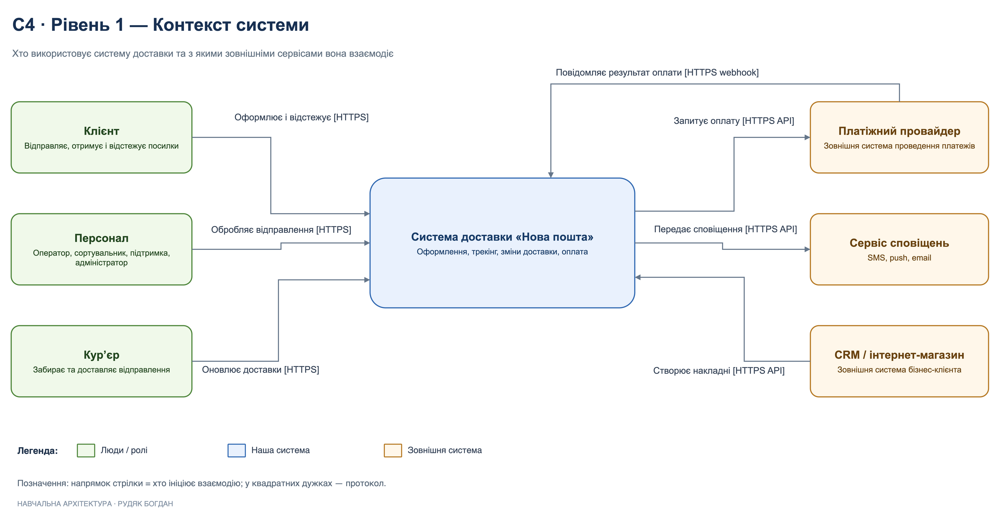
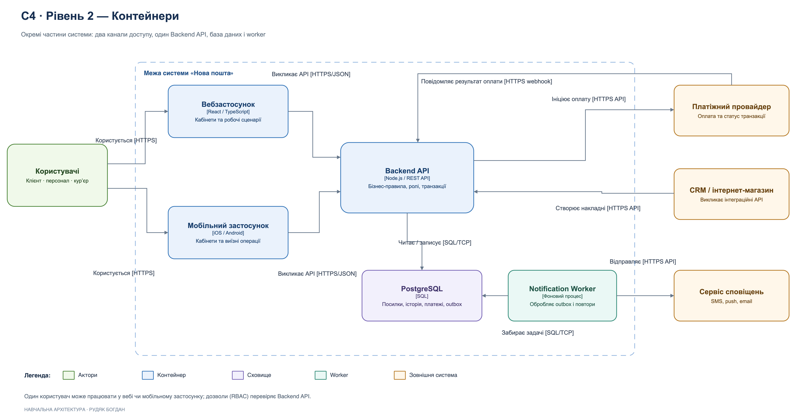
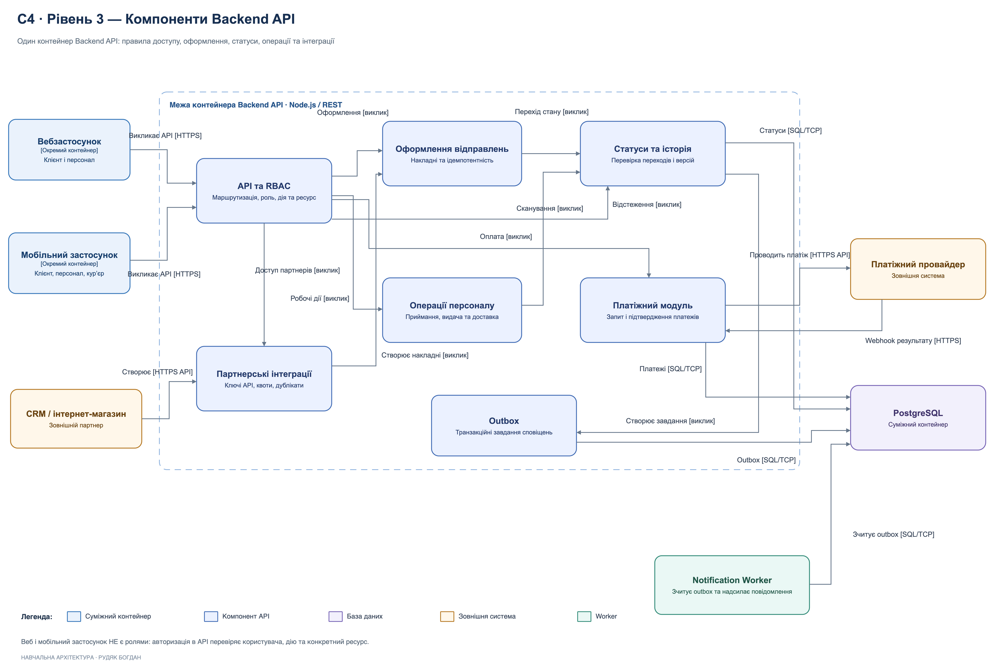

# C4-модель системи доставки «Нова пошта»

## Загальний опис C4-моделі

Для проєкту «Нова пошта» розроблено C4-модель архітектури програмного забезпечення, яка складається з трьох рівнів:

1. **Level 1 — System Context:** показує основних користувачів системи та її взаємодію із зовнішніми сервісами.
2. **Level 2 — Container Diagram:** показує основні технічні частини системи та зв'язки між ними.
3. **Level 3 — Component Diagram:** деталізує внутрішню будову Backend API та розподіл відповідальності між компонентами.

Основна мета моделі — показати, як організована система доставки, які її частини відповідають за конкретні операції та як вони взаємодіють.

Модель описує запропоновану архітектуру навчального проєкту, а не фактичну внутрішню реалізацію систем компанії.

**Позначення на всіх діаграмах:** напрямок стрілки показує, хто ініціює взаємодію; у квадратних дужках вказано протокол або тип виклику.

---

## Level 1 — System Context

### 1.1. Призначення рівня

Перший рівень показує систему доставки «Нова пошта» як єдину систему: хто її використовує і з якими зовнішніми сервісами вона взаємодіє.

На цьому рівні не показуються внутрішні компоненти, бази даних або окремі програмні модулі.

### 1.2. Головна система

**Система доставки «Нова пошта»**

Це центральний елемент діаграми, який забезпечує оформлення відправлень, відстеження посилок, зміну параметрів доставки та оплату послуг.

Система об'єднує взаємодії клієнтів, працівників, кур'єрів і зовнішніх сервісів.

### 1.3. Основні користувачі

**1. Клієнт**

Клієнт використовує систему для створення відправлень, отримання інформації про посилки, відстеження доставки та оплати послуг. До цієї групи належать відправник, одержувач і бізнес-клієнт.

Наприклад, користувач створює накладну, вказує дані одержувача і надалі перевіряє, де перебуває його посилка.

**2. Персонал**

До цієї групи належать оператори відділень, працівники сортувальних центрів, працівники служби підтримки та адміністратори.

Оператори оформлюють приймання та видачу посилок, працівники сортувальних центрів фіксують етапи сортування, служба підтримки працює зі зверненнями, а адміністратори керують налаштуваннями й доступами.

Ці працівники належать до однієї узагальненої групи на першому рівні, але мають різні права всередині системи.

**3. Кур'єр**

Кур'єр отримує завдання на забір і доставку відправлень, переглядає необхідну інформацію та оновлює статус виконання доставки.

Наприклад, після вручення посилки кур'єр підтверджує виконання завдання в системі.

### 1.4. Зовнішні системи

**1. Платіжний провайдер**

Використовується для проведення платежів за доставку та інші послуги.

Взаємодія двостороння, тому на діаграмі показано дві стрілки:

- система доставки ініціює платіж через HTTPS API провайдера;
- провайдер сам повідомляє системі результат оплати через HTTPS webhook. Саме цей виклик ініціює провайдер, тому стрілка спрямована до системи.

**2. Сервіс сповіщень**

Використовується для надсилання клієнтам SMS, push-повідомлень та електронних листів.

Наприклад, після прибуття посилки у відділення клієнт отримує відповідне повідомлення.

**3. CRM / інтернет-магазин**

Це зовнішня система бізнес-клієнта, яка може автоматично створювати накладні через API системи доставки.

Наприклад, після оформлення замовлення в інтернет-магазині інформація передається до системи доставки без необхідності вручну вводити всі дані.

**Чому на діаграмі немає сервісу карт.** Сервіс карт використовується лише клієнтськими застосунками для відображення карти й маршруту і не бере участі в бізнес-операціях. Довідник відділень зберігається в самій системі, тому в разі недоступності сервісу карт відділення показуються списком. Щоб не перевантажувати модель, цю другорядну залежність на діаграмах не показано.

### 1.5. Взаємодія елементів

На діаграмі показано сім основних зв'язків:

1. Клієнт → Система доставки — оформлення та відстеження відправлень [HTTPS].
2. Персонал → Система доставки — обробка відправлень та робочі операції [HTTPS].
3. Кур'єр → Система доставки — оновлення інформації про доставку [HTTPS].
4. Система доставки → Платіжний провайдер — ініціювання оплати [HTTPS API].
5. Платіжний провайдер → Система доставки — повідомлення про результат оплати [HTTPS webhook].
6. Система доставки → Сервіс сповіщень — надсилання повідомлень [HTTPS API].
7. CRM / інтернет-магазин → Система доставки — автоматичне створення накладних [HTTPS API].

### 1.6. Висновок до першого рівня

Перший рівень показує загальне середовище системи доставки «Нова пошта»: хто користується системою, які основні завдання вона виконує та від яких зовнішніх сервісів залежить.

Внутрішня реалізація тут не розглядається, оскільки вона належить до наступних рівнів C4-моделі.

---

## Level 2 — Container Diagram

### 2.1. Призначення рівня

Другий рівень показує, з яких основних технічних частин складається система та як вони взаємодіють між собою.

На відміну від першого рівня, тут уже відображено вебзастосунок, мобільний застосунок, Backend API, базу даних і окремий процес для сповіщень.

### 2.2. Основні контейнери

**1. Вебзастосунок — React / TypeScript**

Вебзастосунок забезпечує доступ до функцій системи через браузер.

Його можуть використовувати клієнти та працівники компанії. Наприклад, клієнт може створити накладну, а оператор — оформити приймання або видачу посилки.

Вебзастосунок відповідає за інтерфейс користувача та надсилання запитів до Backend API.

**2. Мобільний застосунок — iOS / Android**

Мобільний застосунок дозволяє працювати із системою через смартфон.

Його можуть використовувати звичайні клієнти, кур'єри та інші працівники, якщо для їхніх ролей передбачено відповідні функції.

Наприклад, клієнт відстежує доставку, а кур'єр підтверджує вручення посилки. Для персоналу мобільний застосунок також тимчасово зберігає скани в локальній черзі, якщо зник зв'язок.

**Важливе архітектурне рішення:** вебзастосунок і мобільний застосунок не визначають роль користувача. Це лише два способи доступу до однієї системи.

Права доступу перевіряються на сервері. Тому звичайний користувач може працювати як у вебзастосунку, так і в мобільному застосунку. Працівник також може використовувати доступні йому інтерфейси відповідно до своїх повноважень.

**3. Backend API — Node.js / REST API**

Це центральна серверна частина системи.

Backend API отримує запити від вебзастосунку, мобільного застосунку, зовнішніх інтеграцій і повідомлення платіжного провайдера.

Він відповідає за:

- перевірку користувачів і прав доступу;
- виконання бізнес-правил;
- створення та зміну відправлень;
- перевірку переходів статусів;
- операції з базою даних;
- взаємодію з платіжним провайдером;
- підготовку завдань на сповіщення.

Наприклад, коли клієнт створює накладну, саме Backend API перевіряє отримані дані та виконує необхідні операції.

Backend API не зберігає стан сеансу в пам'яті, тому його можна запускати в кількох екземплярах.

**4. PostgreSQL — база даних**

База даних використовується для зберігання інформації про посилки, поточні статуси, історію змін, платежі та завдання сповіщень (outbox).

Зміни статусів повинні виконуватися узгоджено, щоб система не втрачала дані або не показувала неправильний стан посилки.

**5. Notification Worker — фоновий процес**

Notification Worker відповідає за обробку завдань на сповіщення.

Він окремо від Backend API читає збережені завдання з бази даних і звертається до зовнішнього сервісу повідомлень.

Це дозволяє не затримувати основні операції, якщо сервіс SMS або email тимчасово недоступний.

Наприклад, система може успішно зберегти статус «Прибуло у відділення», а повідомлення користувачу надіслати трохи пізніше.

### 2.3. Взаємодія контейнерів

Основні зв'язки другого рівня:

1. Користувачі взаємодіють із вебзастосунком або мобільним застосунком [HTTPS].
2. Обидва застосунки надсилають запити до Backend API [HTTPS/JSON].
3. Backend API читає та записує інформацію в PostgreSQL [SQL/TCP].
4. Backend API ініціює оплату через зовнішнього платіжного провайдера [HTTPS API].
5. Платіжний провайдер повідомляє Backend API результат оплати [HTTPS webhook].
6. CRM та інтернет-магазини створюють накладні через інтеграційний API [HTTPS API].
7. Notification Worker забирає завдання з PostgreSQL і оновлює їхній стан [SQL/TCP].
8. Notification Worker надсилає повідомлення через зовнішній сервіс сповіщень [HTTPS API].

### 2.4. Чому система розділена саме так

Розділення на контейнери дозволяє визначити відповідальність різних частин системи.

Вебзастосунок і мобільний застосунок відповідають за взаємодію з користувачами, Backend API — за бізнес-логіку, PostgreSQL — за збереження даних, а Notification Worker — за фонове надсилання повідомлень.

Окремий Notification Worker потрібен тому, що сповіщення мають інші вимоги до швидкості та обробки помилок, ніж основні операції з посилками.

Водночас основну бізнес-логіку залишено в одному Backend API, щоб не ускладнювати систему великою кількістю незалежних сервісів без необхідності.

### 2.5. Висновок до другого рівня

Другий рівень показує технічну структуру запропонованої системи.

Головний принцип полягає в тому, що різні інтерфейси використовують спільну серверну логіку. Права доступу визначаються не тим, з якого застосунку працює людина, а її роллю та дозволами.

---

## Level 3 — Component Diagram

### 3.1. Призначення рівня

Третій рівень деталізує внутрішню структуру одного контейнера — Backend API.

На цьому рівні показано, які компоненти відповідають за окремі бізнес-функції та як вони взаємодіють.

Backend API представлений як одна серверна програма, усередині якої логіка поділена за відповідальністю. Вебзастосунок, мобільний застосунок, PostgreSQL і Notification Worker показані як суміжні контейнери.

### 3.2. Основні компоненти Backend API

**1. API та RBAC**

Це компонент, через який проходять запити користувачів.

Його завдання — маршрутизація запитів, автентифікація та перевірка прав доступу.

RBAC (Role-Based Access Control) означає керування доступом на основі ролей. Наприклад:

- клієнт може переглядати та змінювати дозволені йому відправлення;
- оператор може виконувати операції приймання та видачі;
- кур'єр може оновлювати інформацію про призначені йому доставки;
- адміністратор отримує доступ до адміністративних функцій.

При цьому потрібно враховувати не тільки роль, а й конкретний об'єкт. Наприклад, клієнт не повинен отримувати доступ до чужого приватного відправлення лише тому, що має роль «Клієнт».

**2. Оформлення відправлень**

Компонент відповідає за створення накладних і перевірку даних відправлення.

Також він повинен забезпечувати ідемпотентність операцій: випадкове повторення одного запиту не повинно призводити до створення кількох однакових накладних.

Наприклад, якщо користувач двічі натиснув кнопку створення відправлення або повторив запит після timeout, система повертає ту саму накладну.

Накладні, які надходять від CRM, також створюються цим компонентом, тому правила перевірки й ідемпотентності однакові для всіх каналів.

**3. Статуси та історія**

Компонент відповідає за поточний стан посилки та історію його змін.

Він перевіряє, чи дозволений перехід з одного статусу в інший, і захищає інформацію від конфліктів при одночасних оновленнях.

Наприклад, якщо два працівники майже одночасно намагаються змінити статус однієї посилки, система повинна правильно обробити ці запити. Для цього в запропонованій архітектурі передбачено перевірку версій даних.

Цей компонент також обслуговує запити відстеження: API та RBAC після перевірки доступу звертається до нього за поточним статусом та історією.

**4. Операції персоналу**

Цей компонент реалізує робочі операції працівників і кур'єрів: приймання, видачу, сканування, передавання та доставку відправлень.

Наприклад, оператор сканує штрихкод посилки, після чого система перевіряє операцію та звертається до компонента статусів для фіксації зміни.

**5. Партнерські інтеграції**

Компонент забезпечує взаємодію з CRM-системами та інтернет-магазинами.

Він відповідає за перевірку API-ключів, контроль лімітів запитів та обробку повторних звернень.

Наприклад, інтернет-магазин автоматично передає запит на створення накладної. Компонент перевіряє доступ зовнішньої системи, а потім передає створення накладної компоненту «Оформлення відправлень».

Зв'язок «API та RBAC → Партнерські інтеграції» використовується, коли бізнес-клієнт у своєму кабінеті керує API-ключами та налаштуваннями інтеграції.

**6. Платіжний модуль**

Компонент відповідає за взаємодію з платіжним провайдером.

Він ініціює оплату через HTTPS API провайдера, приймає webhook із результатом оплати, перевіряє його підпис і зберігає платежі в PostgreSQL.

Особливо важливо не допускати повторного списання коштів при повторних запитах і повторної обробки того самого webhook.

**7. Outbox**

Outbox — компонент підготовки та збереження завдань на сповіщення.

Його завдання — зробити так, щоб інформація про необхідність повідомити клієнта не загубилася після зміни статусу посилки.

Наприклад, після успішної зміни статусу створюється запис про сповіщення. Окремий Notification Worker згодом зчитує цей запис і надсилає повідомлення.

Запис статусу та завдання outbox виконуються в межах однієї транзакції бази даних.

### 3.3. Взаємодія компонентів

На третій діаграмі показано такі основні зв'язки:

1. Вебзастосунок і мобільний застосунок звертаються до компонента API та RBAC [HTTPS].
2. API та RBAC передає запити до компонентів оформлення, операцій персоналу, партнерських інтеграцій та оплати [виклик].
3. API та RBAC звертається до компонента статусів для відстеження посилок [виклик].
4. Компонент оформлення використовує компонент статусів для фіксації початкового стану накладної [виклик].
5. Операції персоналу звертаються до компонента статусів [виклик].
6. CRM та інтернет-магазини звертаються до компонента партнерських інтеграцій [HTTPS API].
7. Партнерські інтеграції передають створення накладних компоненту оформлення [виклик].
8. Компонент статусів працює з PostgreSQL [SQL/TCP].
9. Компонент статусів створює завдання через Outbox [виклик].
10. Outbox записує завдання в PostgreSQL [SQL/TCP].
11. Платіжний модуль звертається до платіжного провайдера [HTTPS API].
12. Платіжний провайдер надсилає webhook із результатом до платіжного модуля [HTTPS].
13. Платіжний модуль зберігає платежі в PostgreSQL [SQL/TCP].
14. Notification Worker окремо зчитує завдання з бази даних [SQL/TCP].

Таким чином, кожен компонент виконує конкретну групу завдань, а зовнішні системи взаємодіють лише з визначеними частинами архітектури.

### 3.4. Приклад роботи системи

Розглянемо ситуацію, коли працівник приймає посилку у відділенні.

**Крок 1.** Працівник відкриває робочий інтерфейс і сканує накладну.

**Крок 2.** Запит надходить до Backend API, де перевіряються особа працівника, його роль і право виконати операцію саме над цією посилкою.

**Крок 3.** Компонент операцій персоналу обробляє сканування та ініціює відповідну зміну стану посилки.

**Крок 4.** Компонент статусів перевіряє дозволений перехід і актуальну версію запису, після чого зберігає зміни.

**Крок 5.** У тій самій транзакції через Outbox створюється завдання на сповіщення клієнта.

**Крок 6.** Notification Worker зчитує завдання з бази даних і звертається до зовнішнього сервісу сповіщень.

**Результат:** статус посилки оновлено, історію збережено, а повідомлення надсилається незалежно від швидкості роботи основного API.

### 3.5. Чому компоненти розділені

Компоненти розділені за відповідальністю, щоб зміни в одній частині бізнес-логіки не вимагали перероблення всього Backend API.

Наприклад, зміна правил статусів насамперед стосується компонента статусів, а зміна інтеграційного API — компонента партнерських інтеграцій.

Таке розділення полегшує розробку, тестування та підтримку системи.

Водночас ці компоненти не є окремими мікросервісами. У нашій моделі вони працюють у межах одного Backend API.

### 3.6. Висновок до третього рівня

Третій рівень показує внутрішню організацію серверної частини системи та розподіл відповідальності між компонентами.

Особливу увагу приділено перевірці прав доступу, захисту статусів посилок від некоректних змін, запобіганню дублюванню операцій і платежів та надійному створенню завдань на сповіщення.

---

## Загальний висновок

У результаті побудовано три рівні C4-моделі системи доставки «Нова пошта».

Перший рівень показує взаємодію системи з користувачами та зовнішніми сервісами.

Другий рівень показує основні технічні контейнери: вебзастосунок, мобільний застосунок, Backend API, PostgreSQL та Notification Worker.

Третій рівень деталізує Backend API і показує, як окремі компоненти відповідають за доступ, відправлення, статуси, операції персоналу, платежі, інтеграції та сповіщення.

Основна перевага запропонованої архітектури — чіткий розподіл відповідальності. Користувачі можуть працювати через різні інтерфейси, але перевірка прав і бізнес-правил виконується централізовано.

## Редагований файл діаграм

Усі три рівні містяться в одному файлі [C4_1-3_Levels.drawio](C4_1-3_Levels.drawio) на трьох окремих вкладках:

1. «01 Контекст (Level 1)».
2. «02 Контейнери (Level 2)».
3. «03 Компоненти API (Level 3)».

Файл можна відкрити на [app.diagrams.net](https://app.diagrams.net) (меню «File → Open from → Device») або в застосунку draw.io Desktop.
